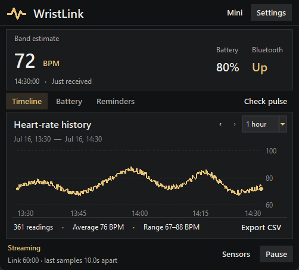
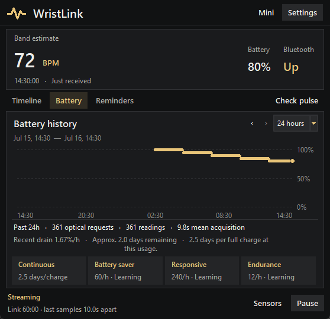
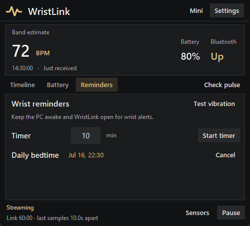
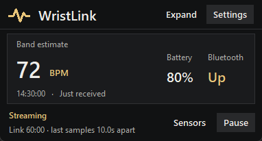

# WristLink

WristLink connects a Brookstone LA380 wristband to a Windows PC over Bluetooth LE and sends its heart-rate estimate to a VRChat avatar over OSC. It also records a local timeline while VRChat is closed.

**[Download WristLink for Windows x64](https://github.com/bingbongs/WristLink/releases/latest/download/WristLink-Windows-x64.zip)** · [Setup and troubleshooting](docs/Quick%20Start.txt)



All screenshots show the app running with synthetic example data.

## Connect your wristband

1. On a Windows x64 PC with Bluetooth LE, extract the download and open `WristLink.exe`. The Windows build includes its own runtime.
2. Put on the band and wake it near the PC. WristLink checks the device model and connects automatically when it finds a single LA380. If it finds several, select yours in **Sensors**. Allow Windows pairing if prompted.
3. In VRChat, open the Action Menu and select **OSC → OSC Debug** to see incoming values. To show BPM on an avatar, its heart-rate display must use a matching OSC parameter. [VRChat OSC debugging guide](https://docs.vrchat.com/docs/osc-debugging)

### Connect an avatar

By default, WristLink sends to `127.0.0.1` on UDP port `9000`.

| Default OSC address | Type | What your avatar receives |
| --- | --- | --- |
| `/avatar/parameters/HeartRate` | Int | Latest accepted BPM, capped at 255 |
| `/avatar/parameters/HeartRateActive` | Bool | Whether a recent estimate is available for display |

**Settings** lets you change the destination and parameter names, select normalized Float output, and enable aliases for existing prefabs. The quick start lists the aliases and explains how the optional jump check handles abrupt changes.

## How often readings change

**Continuous** keeps one Bluetooth connection open. The app starts another optical measurement as soon as the last one finishes, up to once per second. With an OSC receiver listening, it repeats a fresh, accepted BPM about once per second. Only a new sensor reading adds a point to the timeline.

On a physical LA380 running firmware V35960, a four-minute test yielded 19 distinct readings at a median spacing of 11.3 seconds. One optical request stalled and recovered on the same Bluetooth link. Lower-power profiles space the requests farther apart. Actual sampling time and battery life depend on the band and its use.

## Views

| Battery | Reminders |
| --- | --- |
|  |  |

The **Battery** view estimates runtime after it observes enough discharge. **Reminders** can vibrate the wristband for a countdown or daily bedtime while the PC is awake and WristLink is open.

**Mini** keeps the current BPM, sample age, charge and link status visible in a smaller window.



## History and device support

Readings, battery reports and Bluetooth events are stored under `%LOCALAPPDATA%\WristLink`. Use **Timeline → Export CSV** to save a copy. The Brookstone LA380 has been tested on physical hardware. Devices that expose the standard Bluetooth Heart Rate Service can also be selected in **Sensors**. Other FitPro wristbands may use different commands.

## Run from source

From the repository root, use PowerShell and 64-bit Python 3.12.

```powershell
py -3.12 -m venv .venv
.\.venv\Scripts\python.exe -m pip install -r requirements.txt
.\.venv\Scripts\python.exe -m unittest -v test_bridge
.\.venv\Scripts\python.exe wristlink.py
```

Run `.\build.ps1` to build `dist\WristLink.exe`. The driver notes cover the BLE commands, sample decoding and duplicate detection. [Device protocol](docs/Protocol.txt) · [Third-party notices](Third-party%20notices.txt)
